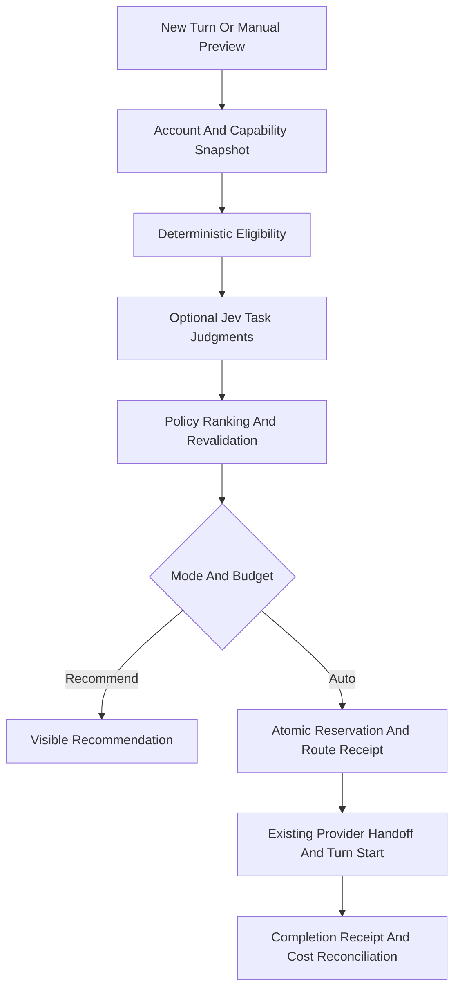

# Routing Architecture

Status: proposed. Companion: [PRD](PRD.md), [Program Design](PROGRAM-DESIGN.md), [Slices](SLICES.md).

## Execution Boundary

Run routing inside the existing Workbench environment server. It already owns provider processes and credentials. A remote server may make recommendations for its own environment, but cannot silently take ownership of subscriptions signed in only on the Mac. No new public service, Python browser agent, queue service, or cron is necessary.

Semantic inference stays outside the pure orchestration decider. The shipped per-message router (`RoutingService.select`, called from `message.dispatch` in `Orchestrator.ts`) runs inline under the thread lock rather than as a durable effect: it picks model and effort within the thread's provider, waits at most four seconds for Jev, and falls back to local rules. This is safe to replay because an accepted command receipt returns before selection, decisions are stored once per command, and Jev recovers a prior judgment for the same task instead of charging again. The `routingMode` setting defaults to `shadow`, which records the pick and leaves the model alone; only `automatic` applies it. Hand-picked models, scheduled tasks, agent-to-agent sends, continuations and steering are never rerouted, and a provider is changed only for a new thread whose own account cannot take work. A durable effect with its own receipt is still the design for anything that changes provider mid-thread.

## Reuse And New Responsibilities

| Existing Code                                                                             | Reuse                                                                                 |
| ----------------------------------------------------------------------------------------- | ------------------------------------------------------------------------------------- |
| `packages/contracts/src/providerInstance.ts`                                              | Environment-local provider instances; do not equate instance ID with account identity |
| `packages/contracts/src/providerUsageLimits.ts`                                           | Provider windows, checked-at time, credential fingerprint, unavailable reason         |
| `apps/server/src/provider/Services/ProviderRegistry.ts`                                   | Available drivers and instances                                                       |
| `apps/server/src/provider/Layers/grokUsageLimits.ts`                                      | Grok usage and isolated home handling                                                 |
| `apps/server/src/serverSettings.ts`                                                       | Existing atomic provider settings persistence                                         |
| `apps/server/src/orchestration-v2/Orchestrator.ts` and `EffectWorker.ts`                  | Durable commands, effects and receipts                                                |
| `apps/server/src/orchestration-v2/ProviderTurnStartService.ts`                            | Start through existing adapter boundary                                               |
| `apps/server/src/orchestration-v2/ContextHandoffService.ts` and `ContextHandoffBudget.ts` | Existing provider handoff, history coverage and token budgets                         |

New domain modules are RoutingService (workflow), routingPolicy (pure eligibility/ranking), JevClient (validated external contract), and RoutingStore (decisions and budget reservations). Extend existing services rather than duplicating account probes, handoffs, or dispatch logic.

## Account And Quota Model

An account key combines environment, driver, and verified opaque credential/account identity. Provider aliases using the same identity share usage and cannot double the apparent allowance. Distinct Grok accounts use distinct `GROK_HOME` directories and interactive sign-ins; copying authentication files is not account setup. Until distinct identity is established, automatic routing excludes the duplicate/unknown entry.

Keep each provider window and reset independently. Any applicable exhausted window blocks automatic selection. Unknown quota is ineligible for quota-optimized automatic routing; a manually pinned account may still run with a truthful unknown indicator. Probe failure retains the last snapshot with its age. Never redeem reset credits automatically. Explicit provider throttles take precedence over local preference scores.

## Jev Integration

Use the TypeSafe-compatible endpoint at `https://openrouter.ai/api/alpha/decisions` with the existing OpenRouter key. The current advisory client pins Jev 1.13 and validates its dated endpoint and price before sending. Send bounded task requirements and permitted context; never credential files, terminal environment dumps, or whole histories by default. A project that disallows external routing judgments uses deterministic policy only.

Batch independent Choice questions for task class, capability requirement, and reasoning requirement. Each question defines concrete criteria, includes an unknown/insufficient-evidence answer, and stands alone. Verify enum membership, finite probabilities, distribution consistency, model version, and usage. Confidence measures concentration, not correctness or authorization. UI explanations come from factual policy reason codes, not invented Jev reasoning.

Jev recommendations never expand eligible candidates. Revalidate immediately before reservation. A timeout, invalid output, stale revision, or outage yields a conservative recommendation or no eligible route; it cannot trigger a paid fallback silently.

## Persistence And Transport Shapes

New authenticated typed RPCs, carried by the existing WebSocket transport:

- Current `routing.preview`: exact provider instance + bounded draft + project directory → read-only result carrying allowances, skills, the routing mode, each account's model ladder and the decision scorecard (see the compiled contract). It never dispatches; do not treat the preview as a dispatch authorization.
- `routing.setPolicy`: `{scope, expectedVersion, policy}` → versioned policy; existing settings authorization applies.
- `routing.listDecisions`: `{threadId, cursor}` → paginated sanitized receipts.

Service methods are also the entry point for scheduled/agent work. Never trust a client-supplied cost, candidate list, eligibility flag, or quota.

Persistent shapes, migration number allocated at implementation:

- `routing_policies`: scope, version, mode, allowed accounts/models, reserve preference, cost caps, privacy policy.
- `routing_decisions`: id, run/command ID, input revision/hash, policy/catalog version, account key, model, effort, reason codes, judgment summary, quota age, reservation ID, status, timestamps. Unique applied decision per run.
- `routing_reservations`: id, decision ID, budget period, reserved micro-USD, reconciled micro-USD, status, provider receipt ID. Unique decision/charge identity.

Use the existing SQLite transaction and effect outbox pattern. No raw task text or secrets in routing receipts. Retain a compact outcome record for evaluation; use existing user-owned thread history for debugging.

## Cost And Continuity

Daily, monthly, and per-turn admission counts reservations plus settled spend; include the Jev request itself. Unknown charges retain their reservation until reconciliation. A strict cap is possible only where the provider/harness enforces a request bound and all chargeable requests pass admission. Unbounded agent loops are ineligible for strict paid auto mode until their adapter exposes that control. UI must distinguish a hard admission cap from an estimated total bill; external use of the same key is not controlled by this app.

Free-only execution cannot fall back to `openrouter/auto` or paid Jev. A zero-priced current catalog and supported free endpoint are required. Subscription marginal API cost and prepaid plan price are separate concepts.

Keep provider/model/account pinned during an active turn. Before a provider change, reuse the handoff service and check coverage of original goal, accepted decisions, current artifacts/checkpoint, unresolved approvals, and relevant tool receipts. Do not truncate an unresolved approval or silently change execution permissions. Insufficient context capacity produces a visible block. Do not replay an uncertain tool side effect on another model. Respect provider cooldowns; do not automatically rotate accounts to evade account/service limits.

## Hiding A Provider's Own Skill List

`hidesSkillListing` (`apps/server/src/skills/skillListing.ts`) is the one rule: `skillListing: "selected"` with Auto on. It is wired for Claude (SDK `skills: []`), Codex with a shadow home, OpenCode per-session servers and the Antigravity profile. Three cases have no switch that can be verified from this codebase. Checked 2026-10-06 against Grok 1.0.46 and `@cursor/sdk` 1.0.31; do not retry these without a newer version or a way to run a signed-in session.

**Grok.** Tested with `grok inspect --json` under a throwaway `HOME`/`GROK_HOME` holding skills in `~/.grok`, `~/.claude`, `~/.cursor` and `~/.agents`.

- `[compat.claude] skills = false` and `[compat.cursor] skills = false` in `config.toml`, and the `GROK_CLAUDE_SKILLS_ENABLED=false` / `GROK_CURSOR_SKILLS_ENABLED=false` variables: `externalCompat` reports the cell as off, but the skill list is unchanged.
- `GROK_CONFIG` and `GROK_CONFIG_PATH` overlays: the overlay is limited to `models`, `features`, `toolset` and `shell_environment_policy`, so `skills.*` and `compat.*` set there are dropped.
- `[skills] disabled` only deactivates a named skill and keeps it listed.
- `[skills] ignore = ["~/.grok", "~/.claude", ...]` in `$GROK_HOME/config.toml` does empty the list, but only from the user's config file layer. Delivering it per session means pointing Grok at a different `GROK_HOME`. That home also owns `auth.json` (no environment variable moves it; `GROK_AUTH_PATH` is only scrubbed from auth-provider subprocesses), sessions, MCP credentials, memory and bundled skills. Sharing auth by symlink risks a token refresh replacing the link and leaving the real file with a rotated-out refresh token. That could not be tested without signing in, so it is not wired.
- `grok agent stdio` accepts no skills flag, and `session/new` does not answer without a login, so what the agent itself lists could not be observed either.

**Cursor.** `@cursor/sdk` has no skills option. `settingSources` (`project`, `user`, `team`, `mdm`, `plugins`) gates rules, skills and agents through a single `localExtensibility` switch per source, and hooks and MCP through the same sources. Dropping `user` would also drop `~/.cursor/rules`, user hooks and user MCP servers; dropping `project` would drop `AGENTS.md` and project rules. The user home the SDK scans (`~/.cursor`, `~/.claude`, `~/.codex`, `~/.grok`, `~/.agents`, `~/.cursor/skills-cursor`) is `os.homedir()`, not an option, and the SDK runs inside the server process, so changing `HOME` would change it for everything else.

**Codex using `~/.codex` directly.** `skills/config/write` persists to the user's `config.toml`. Per-thread `config` overrides could carry `skills.config` entries with `enabled = false` for every listed skill, which would not touch the user's files, but whether Codex applies session overrides to skill rules could not be checked: no Codex binary is installed where this was worked on. A shadow home (Settings, Codex) is the supported way to hide the list.
